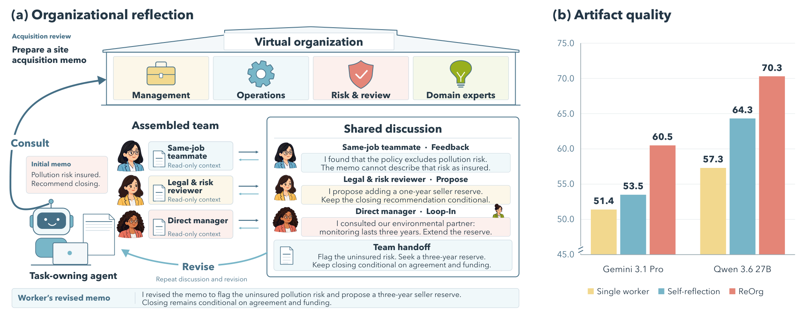

# ReOrg: Evolving Reflective Organization Skills for Enterprise Agents

Di Wu, Rujun Han, Yanfei Chen, Yifei Ming, Han Yu, Yufan Zhuang, Tomas Pfister, Chen-Yu Lee

## 🧬 Overview

<p align="center">
  
</p>

A long-horizon worker agent can finish every requested step and still produce an artifact that is not ready for others to use. ReOrg places one worker inside a virtual organization. A planner assembles simulated stakeholders (a direct manager, a legal and risk reviewer, a same-job teammate, …), who inspect the current artifact in read-only contexts and hand back their contributions. The worker alone revises the deliverable, for up to three rounds.

Who to consult and how their contributions are combined is stored as a reusable **organizational reflection skill**: a small directed graph whose nodes pair a stakeholder role with one of three actions (Feedback, Propose, Loop-In). ReOrg learns a library of such skills from unlabeled tasks through evolutionary beam search ranked by a label-free judge, and it accumulates planner knowledge about which skills to use when.

### ✨ Key features

* **One worker, many perspectives.** Stakeholders never edit the deliverable. They inspect it with local tools and pass their contributions forward along the skill graph to the worker.
* **Reusable organizational routines.** A skill stores roles, actions and communication structure, never task content. The same skills transfer across GDPval, JobBench and LAB, and across model families.
* **Learning without labels.** Candidate skills are judged by the artifacts they produce, through blinded group-wise ranking with a tie-aware strength model. No reference answers or rubrics are used during learning.
* **One execution path.** All three benchmarks share one skill format, round scheduler, work chronicle, Loop-In protocol, planner and loop, on the official [Stirrup](https://github.com/ArtificialAnalysis/Stirrup) agent. A benchmark contributes only its data, its action runtime and its judge.

## 🧩 Method to code

| Paper | Code |
|---|---|
| Task packet $x=(u,\mathcal{R})$ (Sec. 3.1) | `reorg/domain.py: TaskPacket`; built by `data/<name>/adapter.py: load_task` |
| Reflection skill $s=(V,E)$, node $(\rho_v, a_v)$, at most 10 nodes (Sec. 3.3) | `reorg/reflection_skill/graph.py: ReflectionSkill`, with `fingerprint` as the execution identity |
| $\mathrm{Reflect}(x, A_{r-1}, H_{r-1}; s_r)$ and the revision $A_r$ (Eq. 1) | `reorg/reflection_skill/reflect.py: reflect, work` |
| Work chronicle $H_r$; Loop-In (App. A.1) | `reorg/reflection_skill/chronicle.py`; `reorg/reflection_skill/loop_in.py` |
| Worker and stakeholders as Stirrup sessions; models | `reorg/worker.py: run_agent`; `reorg/llm.py` (Gemini API, native vLLM) |
| Benchmark action prompts, tools, staging, submission (App. A.4) | `data/<name>/runtime.py` (+ `tools.py`, `prompts/`, `reorg.json`) |
| Planner: first-round retrieval, work-state projection, completion gate, later-round retrieval (App. A.3) | `reorg/planner.py` |
| Inference with up to three reflection rounds | `reorg/inference.py` |
| Library $\mathcal{L}$ and planner knowledge $M$ | `reorg/library.py` (`skills/`, `records.jsonl`, `lessons.md`, `precedents.md`) |
| Alg. 1: seeds, Retrieve, Mutate, rank, beam, Promote, Summarize (Sec. 4, App. A.2) | `reorg/continual_learning/`: `learn.py`, `seeds.py`, `mutate.py`, `ranking.py`, `aggregate.py` (tie-aware Davidson fit), `search.py`, `knowledge.py` |
| Later-round precedents: 8 sampled skills vs. the unchanged parent (App. A.3) | `reorg/continual_learning/later_round.py` |
| Worker web search | `reorg/web_search.py`; JobBench's guarded variant in `data/jobbench/tools.py` |
| Evaluation (App. A.5) | `data/gdpval/judge/` (three-judge panel), `data/jobbench/judge.py`, `data/lab/judge.py` |
| Prompt templates P1–P11, stakeholder profiles R1–R10 (App. A.6–A.7) | `reorg/prompts/` (sha256 in `reorg/prompts/manifest.json`) |
| Settings (App. A.2–A.5) | `configs/{inference,learning}.json`, `configs/models/`, `configs/judges/`, `data/<name>/reorg.json` |

## ⚡️ Quickstart

### 0. Install

```bash
git clone <this repository> reorg && cd reorg
pip install -e ".[dev]"            # Python 3.12 or newer; installs Stirrup at the pinned commit
python3 -m pytest tests            # offline: no API calls, no benchmark data
```

### 1. Models

The paper uses Gemini 3.1 Pro and Qwen 3.6 27B (`configs/models/`). Every role (worker, stakeholders, planner, learning judge) uses the same model.

```bash
export GEMINI_API_KEY=...                         # Gemini; Qwen runs need it too, for the worker's web search
vllm serve Qwen/Qwen3.6-27B --revision 6a9e13bd6fc8f0983b9b99948120bc37f49c13e9 \
    --reasoning-parser qwen3 --enable-auto-tool-choice --tool-call-parser qwen3_coder
export VLLM_BASE_URL=http://<host>:8000/v1        # Qwen through vLLM's own OpenAI-compatible server
```

Workers, stakeholders and judges execute code on the host inside per-action sandbox directories; use a disposable VM.

### 2. Prepare the benchmarks

No benchmark data is stored in this repository, only task-ID lists. `prepare` downloads each benchmark at a pinned revision into `downloads/<benchmark>/`, which is git-ignored, and verifies it against `data/<benchmark>/splits/manifest.json`:

```bash
python3 reorg.py --benchmark gdpval prepare      # openai/gdpval on Hugging Face, about 2.3 GB
python3 reorg.py --benchmark jobbench prepare    # JobBench/job-bench on Hugging Face, about 0.6 GB
python3 reorg.py --benchmark lab prepare         # a harveyai/harvey-labs checkout, about 2 GB
```

### 3. Learn, infer, evaluate

```bash
# Alg. 1 on the 20 GDPval adaptation tasks, then later-round precedents (resumable)
python3 reorg.py --benchmark gdpval learn --out runs/gdpval/learn --model gemini_3_1_pro
python3 reorg.py --benchmark gdpval learn-later --library runs/gdpval/learn/library --out runs/gdpval/later --model gemini_3_1_pro

# up to three reflection rounds with the frozen library, on the 185-task cohort, then the three-judge panel
python3 reorg.py --benchmark gdpval infer --library runs/gdpval/later/library --model gemini_3_1_pro --run-id reorg
python3 reorg.py --benchmark gdpval evaluate --run runs/gdpval/reorg

# cross-domain transfer: the GDPval library on JobBench and LAB
python3 reorg.py --benchmark jobbench infer --library runs/gdpval/later/library --model gemini_3_1_pro --run-id transfer
python3 reorg.py --benchmark jobbench evaluate --run runs/jobbench/transfer
```

`--max-rounds 0` runs the worker alone. Evaluation needs, in addition:
- **GDPval:** `VLLM_BASE_URL` for the Qwen judge, and `VERTEX_PROJECT` with Google Cloud application-default credentials (`pip install -e ".[gdpval-eval]"`) for the Claude Sonnet 4.6 judge.
- **JobBench:** `git` and `uv`. The judge fetches the pinned upstream evaluator and runs in that evaluator's own environment.
- **LAB:** `pandoc` and `pip install -e ".[lab-eval]"`.

### Task sets

```bash
python3 reorg.py --benchmark lab tasks --set eval --check        # adapt | eval | heldout | smoke
```

| Domain | Adaptation stream | Evaluation cohort | Held out |
|---|---|---|---|
| [GDPval](data/gdpval/README.md) | 20 | 185 (every task with an expert deliverable) | 165 |
| [JobBench](data/jobbench/README.md) | 20 (10 main + 10 easy) | 128 (65 main + 63 easy) | 108 |
| [LAB](data/lab/README.md) | 20 (from train + valid) | 200 (our seeded test split) | 200 |

## 🧱 Adding a benchmark

A benchmark is one directory, `data/<name>/`:

* `adapter.py` exports `DOMAIN`, a `reorg.domain.Domain`:
  * `prepare()` downloads the pinned source into `self.data` and verifies it;
  * `load_task(task_id)` returns a `TaskPacket` with only what the worker may see;
  * it also defines `eval_ids()` and, when the defaults do not apply, `adapt_ids()`, `heldout_ids()` and `smoke_ids()`.
* `runtime.py` exports two functions:
  * `make_runtime(domain, task_id, profile, config)`, a `reorg.reflection_skill.reflect.Runtime` that stages a sandbox and runs one action;
  * `submission(domain, task_id, artifact_dir, out_dir)`.
* `judge.py` (or a `judge/` package) exports `evaluate(run_dir, task_ids, data)`.
* `splits/` holds the task-ID lists and the source pins.

## 🧪 Tests

```bash
python3 -m pytest tests            # offline, with scripted models and runtimes
```

## 🙏 Acknowledgements

The worker, stakeholders and judges run on [Stirrup](https://github.com/ArtificialAnalysis/Stirrup) by Artificial Analysis. The benchmarks are [GDPval](https://huggingface.co/datasets/openai/gdpval), [JobBench](https://huggingface.co/datasets/JobBench/job-bench) with its [evaluator](https://github.com/Job-Bench/job-bench-eval), and [Harvey LAB](https://github.com/harveyai/harvey-labs).

## 💬 Citation

```bibtex
@article{wu2026reorg,
  title={ReOrg: Evolving Reflective Organization Skills for Enterprise Agents},
  author={Wu, Di and Han, Rujun and Chen, Yanfei and Ming, Yifei and Yu, Han and Zhuang, Yufan and Pfister, Tomas and Lee, Chen-Yu},
  year={2026}
}
```

## Contributing

See [CONTRIBUTING.md](CONTRIBUTING.md).

## License

Apache 2.0; see [LICENSE](LICENSE). Benchmark data and evaluators fetched by this code carry their own licenses.

## Disclaimer

This is not an officially supported Google product. This project is not eligible for the [Google Open Source Software Vulnerability Rewards Program](https://bughunters.google.com/open-source-security).
